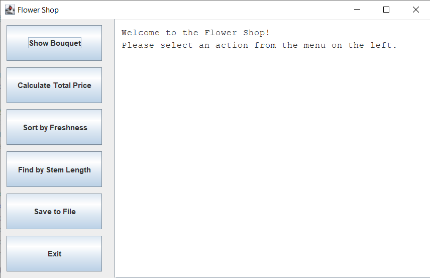
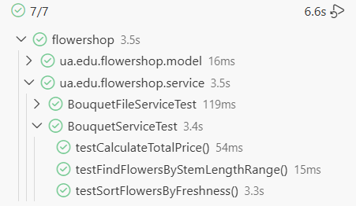

#  Flower Shop

This is a desktop Java application with a graphical user interface (GUI), created as part of a laboratory assignment. The project demonstrates the application of key Object-Oriented Programming (OOP) principles, design patterns, file system operations, and Unit testing code coverage.

---

##  Demonstration

### Graphical User Interface (GUI)
<!-- Replace the path in parentheses with the path to your screenshot -->

### Successful Unit Test Execution
<!-- Replace the path in parentheses with the path to your test screenshot -->

---

##  Key Features
- Assembling a bouquet from various types of flowers (Roses, Tulips, Carnations, Chamomiles) and accessories.
- Calculating the total price of the bouquet.
- Sorting flowers in the bouquet based on their freshness level.
- Finding flowers in the bouquet within a specified stem length range.
- Saving comprehensive bouquet information to a text file.
- Interactive graphical user interface built with **Java Swing**.

---

##  Applied OOP Principles

1. **Encapsulation:**
   All class fields (e.g., `price`, `stemLength`, `freshnessLevel`) are `private`. Access to them is provided exclusively through public methods (getters), which ensures data protection from incorrect external modifications.

2. **Inheritance:**
   An abstract `Flower` class was created containing common characteristics of flowers. Specific flower classes (`Rose`, `Tulip`, `Carnation`, `Chamomile`) extend (inherit from) it, avoiding code duplication. For example, the `Rose` class adds its own unique `hasThorns` field.

3. **Polymorphism:**
   In the `Bouquet` class, the flower collection is stored as a list of the base type `List<Flower>`. This allows adding any objects of derived classes to the bouquet. The program automatically calls the correct methods for specific object types during runtime, particularly when invoking the overridden `@Override toString()` method.

---

##  Technologies and Tools
- **Programming Language:** Java 
- **Build Tool:** Maven
- **GUI:** Java Swing
- **Testing:** JUnit 5, Mockito
- **Version Control:** Git & GitHub (following Conventional Commits)

